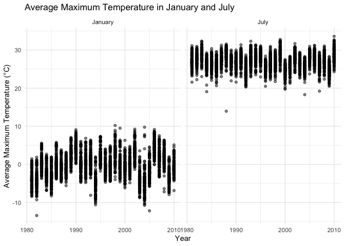
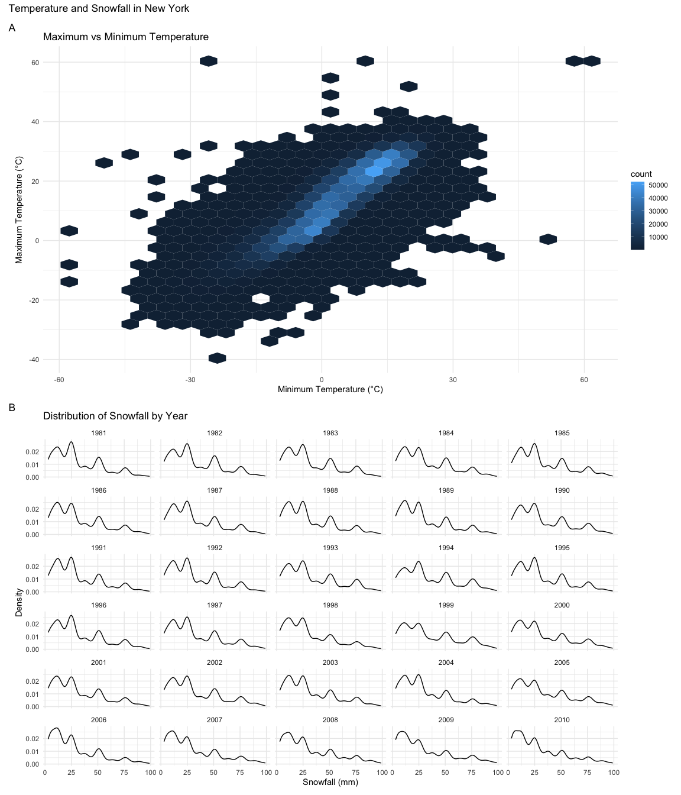
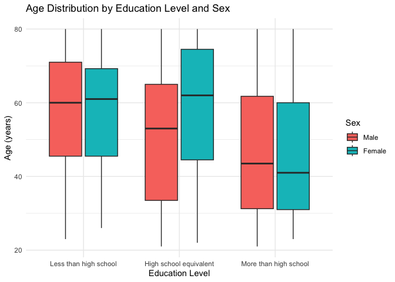
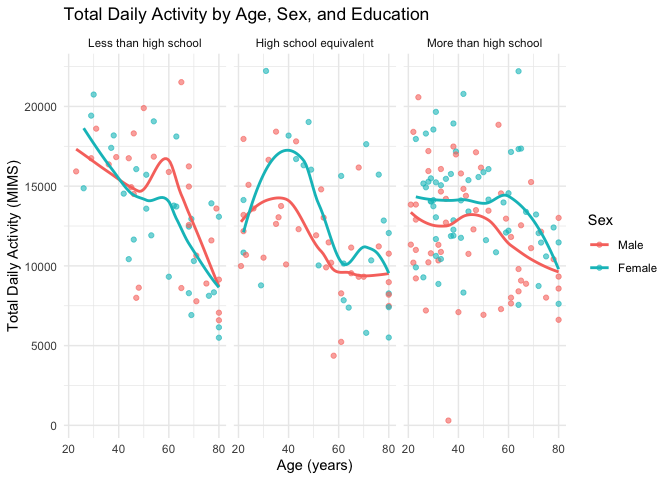
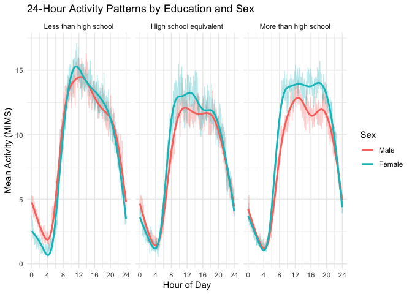
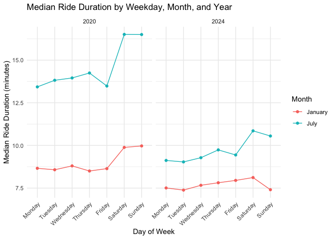
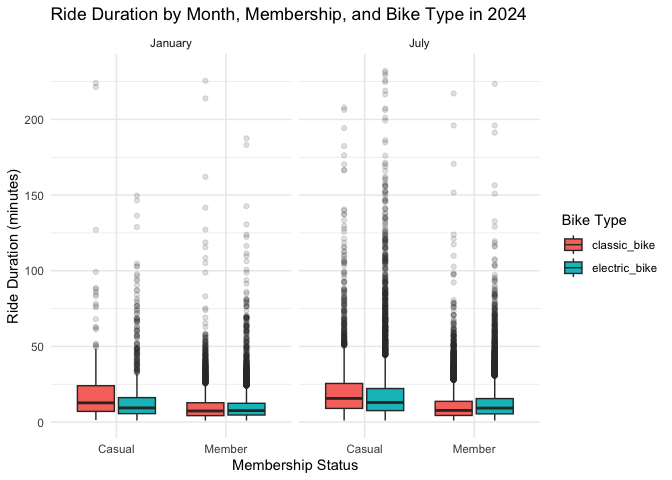
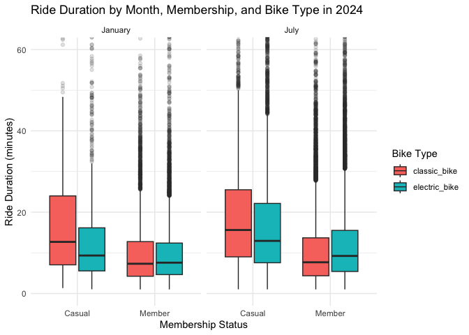

P8105 Homework 3
================
Cecilia Zhao
2026-10-18

## Question 1

``` r
library(p8105.datasets)
data("ny_noaa")

ny_noaa
```

    ## # A tibble: 2,595,176 × 7
    ##    id          date        prcp  snow  snwd tmax  tmin 
    ##    <chr>       <date>     <int> <int> <int> <chr> <chr>
    ##  1 US1NYAB0001 2007-11-01    NA    NA    NA <NA>  <NA> 
    ##  2 US1NYAB0001 2007-11-02    NA    NA    NA <NA>  <NA> 
    ##  3 US1NYAB0001 2007-11-03    NA    NA    NA <NA>  <NA> 
    ##  4 US1NYAB0001 2007-11-04    NA    NA    NA <NA>  <NA> 
    ##  5 US1NYAB0001 2007-11-05    NA    NA    NA <NA>  <NA> 
    ##  6 US1NYAB0001 2007-11-06    NA    NA    NA <NA>  <NA> 
    ##  7 US1NYAB0001 2007-11-07    NA    NA    NA <NA>  <NA> 
    ##  8 US1NYAB0001 2007-11-08    NA    NA    NA <NA>  <NA> 
    ##  9 US1NYAB0001 2007-11-09    NA    NA    NA <NA>  <NA> 
    ## 10 US1NYAB0001 2007-11-10    NA    NA    NA <NA>  <NA> 
    ## # ℹ 2,595,166 more rows

``` r
nrow(ny_noaa)
```

    ## [1] 2595176

``` r
ncol(ny_noaa)
```

    ## [1] 7

``` r
missing_summary =
  ny_noaa |>
  summarise(
    missing_prcp = mean(is.na(prcp)) * 100,
    missing_snow = mean(is.na(snow)) * 100,
    missing_snwd = mean(is.na(snwd)) * 100,
    missing_tmax = mean(is.na(tmax)) * 100,
    missing_tmin = mean(is.na(tmin)) * 100
  )

missing_summary |>
  knitr::kable(digits = 2)
```

| missing_prcp | missing_snow | missing_snwd | missing_tmax | missing_tmin |
|-------------:|-------------:|-------------:|-------------:|-------------:|
|         5.62 |        14.69 |         22.8 |        43.71 |        43.71 |

The `ny_noaa` dataset contains 2595176 observations and 7 variables,
including weather station ID, date, precipitation (`prcp`), snowfall
(`snow`), snow depth (`snwd`), maximum temperature (`tmax`), and minimum
temperature (`tmin`).

Missing data are a substantial issue in this dataset. Precipitation has
the lowest percentage of missing values (5.62%), followed by snowfall
(14.69%) and snow depth (22.8%). Maximum and minimum temperatures have
the highest missing percentages, both at 43.71%.

``` r
ny_noaa_df =
  ny_noaa |>
  mutate(
    year = lubridate::year(date),
    month = lubridate::month(date),
    day = lubridate::day(date),
    tmax = as.numeric(tmax) / 10,
    tmin = as.numeric(tmin) / 10,
    prcp = prcp / 10
  )
```

The original maximum and minimum temperatures (`tmax` and `tmin`) were
recorded in tenths of degrees Celsius, but precipitation (`prcp`) was
recorded in tenths of millimeters. Therefore, I divided these variables
by 10 to convert them into degrees Celsius and millimeters. Snowfall
(`snow`) was already measured in millimeters, so no conversion was
needed.

``` r
snow_summary =
  ny_noaa_df |>
  filter(!is.na(snow)) |>
  count(snow, sort = TRUE)

snow_summary |>
  head(10) |>
  knitr::kable()
```

| snow |       n |
|-----:|--------:|
|    0 | 2008508 |
|   25 |   31022 |
|   13 |   23095 |
|   51 |   18274 |
|   76 |   10173 |
|    8 |    9962 |
|    5 |    9748 |
|   38 |    9197 |
|    3 |    8790 |
|  102 |    6552 |

The most commonly observed snowfall value is 0 mm, which occurrs 2008508
times. This is expected because most days do not experience snowfall.

Other frequently observed values include 25, 13, 51, and 76 mm. These
values are approximately equivalent to common fractions or multiples of
an inch. It suggests that the observed frequencies may reflect
measurement conventions and rounding when converting from inches to
millimeters.

``` r
temp_summary =
  ny_noaa_df |>
  filter(month %in% c(1, 7)) |>
  group_by(id, year, month) |>
  summarise(
    mean_tmax = mean(tmax, na.rm = TRUE),
    .groups = "drop"
  ) |>
  filter(!is.na(mean_tmax))
```

``` r
temp_summary |>
  ggplot(aes(x = year, y = mean_tmax, group = id)) +
  geom_point(alpha = 0.5) +
  scale_x_continuous(breaks = seq(1980, 2010, 10)) +
  facet_grid(. ~ month,
           labeller = as_labeller(c(`1` = "January", `7` = "July"))) +
  labs(
    title = "Average Maximum Temperature in January and July",
    x = "Year",
    y = "Average Maximum Temperature (°C)"
  ) +
  theme_minimal()
```

<!-- -->

The plot shows a clear seasonal difference in average maximum
temperatures between January and July. January temperatures are
generally much lower and more variable. July temperatures are higher and
more concentrated. There is some variation across years, but no obvious
long-term trend.

A few potential outliers are visible in both months, particularly
unusually low average temperatures in January and July. These values may
reflect extreme weather conditions or incomplete observations and would
require further investigation.

``` r
ggp_temp =
  ny_noaa_df |>
  drop_na(tmax, tmin) |>
  ggplot(aes(x = tmin, y = tmax)) +
  geom_hex() +
  labs(
    title = "Maximum vs Minimum Temperature",
    x = "Minimum Temperature (°C)",
    y = "Maximum Temperature (°C)"
  ) +
  theme_minimal()
```

``` r
ggp_snow =
  ny_noaa_df |>
  filter(snow > 0, snow < 100) |>
  ggplot(aes(x = snow)) +
  geom_density() +
  facet_wrap(~ year, ncol = 5) +
  labs(
    title = "Distribution of Snowfall by Year",
    x = "Snowfall (mm)",
    y = "Density"
  ) +
  theme_minimal()
```

``` r
combined_plot =
  (ggp_temp / ggp_snow) +
  plot_annotation(
    title = "Temperature and Snowfall in New York",
    tag_levels = "A"
  )

combined_plot
```

<!-- -->
Panel A: Maximum vs Minimum Temperature:

The plot shows a clear positive relationship between minimum and maximum
temperatures. As minimum temperature increases, maximum temperature
generally increases as well. There are few potential outliers at
unusually high or low temperatures. A hexbin plot is more appropriate
than a scatterplot for this large dataset because it reduces
overplotting and makes the concentration of observations easier to see.

Panel B: Distribution of Snowfall by Year:

My code focuses on snowfall values greater than 0 and less than 100 mm.
So I excluded days with no snowfall and observations with snowfall of
100 mm or more.

The distributions of snowfall are relatively consistent across years.
There are no obvious long-term changes in their overall shapes. Smaller
snowfall amounts are more common, and larger snowfall amounts occur less
frequently. Several peaks appear at similar snowfall values across
years, which may reflect measurement conventions and rounding when
converting snowfall measurements from inches to millimeters.

## Question 2

``` r
demographic_df = read_csv("data/nhanes_covar.csv", skip = 4)

accelerometer_df = read_csv("data/nhanes_accel.csv")
```

``` r
demographic_clean =
  demographic_df |>
  filter(
    age >= 21,
    !is.na(sex),
    !is.na(age),
    !is.na(BMI),
    !is.na(education)
  ) |>
  mutate(
    SEQN = as.character(SEQN),
    sex = factor(
      sex,
      levels = c(1, 2),
      labels = c("Male", "Female"),
    ),
    education = factor(
      education,
      levels = c(1, 2, 3),
      labels = c(
        "Less than high school",
        "High school equivalent",
        "More than high school"
      )
    )
  )
```

``` r
accelerometer_long =
  accelerometer_df |>
  pivot_longer(
    cols = starts_with("min"),
    names_to = "minute",
    values_to = "MIMS"
  ) |>
  mutate(
    SEQN = as.character(SEQN),
    minute = as.numeric(
      stringr::str_remove(minute, "min")
    )
  )
```

``` r
nhanes_df =
  accelerometer_long |>
  inner_join(
    demographic_clean,
    by = "SEQN"
  )
```

``` r
education_sex_df =
  demographic_clean |>
  group_by(education, sex) |>
  summarise(
    n = n(),
    .groups = "drop"
  )
```

``` r
education_sex_df |>
  pivot_wider(
    names_from = sex,
    values_from = n
  ) |>
  knitr::kable()
```

| education              | Male | Female |
|:-----------------------|-----:|-------:|
| Less than high school  |   27 |     28 |
| High school equivalent |   35 |     23 |
| More than high school  |   56 |     59 |

After excluding participants younger than 21 or with missing demographic
information, 228 participants remained from the original 250
participants. The largest education group was more than high school,
with 115 participants. The numbers of men and women were relatively
balanced in the less than high school and more than high school groups.
However, in the high school equivalent group, there were more men (35)
than women (23).

``` r
ggplot(demographic_clean,
  aes(x = education, y = age, fill = sex)
) +
  geom_boxplot() +
  labs(
    title = "Age Distribution by Education Level and Sex",
    x = "Education Level",
    y = "Age (years)",
    fill = "Sex"
  ) +
  theme_minimal()
```

<!-- -->

The age distributions vary across education levels and sex. Participants
with less than a high school education generally have higher median
ages, which are around 60 years for both men and women. In the high
school equivalent group, women have a higher median age than men.
Participants with more than a high school education tend to be younger,
with median ages in the early to mid-40s for both sexes. Overall, the
results suggest that age distributions differ across education
categories, although there is considerable overlap between groups.

``` r
daily_activity_df =
  nhanes_df |>
  group_by(SEQN, sex, age, BMI, education) |>
  summarise(
    total_activity = sum(MIMS),
    .groups = "drop"
  )
```

``` r
ggplot(
  daily_activity_df,
  aes(x = age, y = total_activity, color = sex)
) +
  geom_point(alpha = 0.6) +
  geom_smooth(se = FALSE) +
  facet_wrap(~ education) +
  labs(
    title = "Total Daily Activity by Age, Sex, and Education",
    x = "Age (years)",
    y = "Total Daily Activity (MIMS)",
    color = "Sex"
  ) +
  theme_minimal()
```

<!-- -->

The scatterplots suggest that total daily activity generally decreases
with age, particularly among older participants. Female participants
tend to have slightly higher activity levels than male participants in
several age ranges, but this pattern is not consistent across all
education groups. The high school equivalent group shows more
fluctuations in activity trends. The more than high school group
exhibits relatively stable activity levels through middle age, followed
by a decline among older participants. Overall, the results suggest an
association between age and daily activity, with some differences by sex
and education level.

``` r
activity_time_df =
  nhanes_df |>
  group_by(education, sex, minute) |>
  summarise(
    mean_MIMS = mean(MIMS),
    .groups = "drop"
  ) |>
  mutate(
    hour = (minute - 1) / 60
  )
```

``` r
ggplot(
  activity_time_df,
  aes(x = hour, y = mean_MIMS, color = sex)
) +
  geom_line(alpha = 0.3) +
  geom_smooth(se = FALSE) +
  facet_wrap(~ education) +
  scale_x_continuous(
    breaks = seq(0, 24, 4)
  ) +
  labs(
    title = "24-Hour Activity Patterns by Education and Sex",
    x = "Hour of Day",
    y = "Mean Activity (MIMS)",
    color = "Sex"
  ) +
  theme_minimal()
```

<!-- -->

The 24-hour activity patterns show a clear daily cycle across all three
education levels. Activity levels are lowest during the early morning
hours, increase rapidly after approximately 6 AM, remain relatively high
throughout the day, and decline in the evening. Female participants
generally have higher mean activity levels than male participants during
daytime hours. Participants with less than a high school education show
a pronounced peak around midday. Those with a high school equivalent
education exhibit relatively lower daytime activity levels. Overall, the
results suggest similar daily activity patterns across education groups,
with some differences in activity intensity by sex and education level.

## Question 3

``` r
jan_2020 = read_csv("data/citibike/Jan 2020 Citi.csv.zip")

july_2020 = read_csv("data/citibike/July 2020 Citi.csv.zip")

jan_2024 = read_csv("data/citibike/Jan 2024 Citi.csv.zip")

july_2024 = read_csv("data/citibike/July 2024 Citi.csv.zip")
```

``` r
citibike_df =
  bind_rows(
    jan_2020 |> mutate(year = 2020, month = "January"),
    july_2020 |> mutate(year = 2020, month = "July"),
    jan_2024 |> mutate(year = 2024, month = "January"),
    july_2024 |> mutate(year = 2024, month = "July")
  )
```

``` r
citibike_clean =
  citibike_df |>
  mutate(
    month = factor(
      month,
      levels = c("January", "July")
    ),
    weekdays = factor(
      weekdays,
      levels = c(
        "Monday", "Tuesday", "Wednesday",
        "Thursday", "Friday", "Saturday", "Sunday"
      )
    ),
    member_casual = factor(
      member_casual,
      levels = c("casual", "member"),
      labels = c("Casual", "Member")
    ),
    rideable_type = factor(rideable_type)
  )
```

The cleaned Citi Bike dataset contains 99485 rides from January and July
of 2020 and 2024, with 9 variables describing ride characteristics。 The
dataset includes bike type, day of the week, ride duration, starting and
ending stations, membership status, year, and month. Categorical
variables were converted to factors with appropriate ordering. There are
43 missing starting station names and 207 missing ending station names,
and all other variables have no missing values. Ride durations range
from approximately 1 to 239 minutes, with a median of 9.84 minutes. All
rides were retained for the analysis, except that records with missing
starting station names were excluded when ranking starting stations.

``` r
ride_count_df =
  citibike_clean |>
  group_by(year, month, member_casual) |>
  summarise(
    n_rides = n(),
    .groups = "drop"
  )

ride_count_df |>
  pivot_wider(
    names_from = member_casual,
    values_from = n_rides
  ) |>
  knitr::kable()
```

| year | month   | Casual | Member |
|-----:|:--------|-------:|-------:|
| 2020 | January |    984 |  11436 |
| 2020 | July    |   5637 |  15411 |
| 2024 | January |   2108 |  16753 |
| 2024 | July    |  10894 |  36262 |

Citi Bike members accounted for more rides than casual riders in all
four months. In both 2020 and 2024, July had more rides than January,
which suggests a seasonal pattern in bike usage. The number of rides was
also higher in 2024 than in 2020 for both months. July 2024 had the
highest number of rides, while January 2020 had the lowest.

``` r
top_stations_df =
  citibike_clean |>
  filter(
    year == 2024,
    month == "July",
    !is.na(start_station_name)
  ) |>
  count(
    start_station_name,
    name = "n_rides"
  ) |>
  slice_max(
    order_by = n_rides,
    n = 5,
    with_ties = FALSE
  )

top_stations_df |>
  knitr::kable()
```

| start_station_name       | n_rides |
|:-------------------------|--------:|
| Pier 61 at Chelsea Piers |     163 |
| University Pl & E 14 St  |     155 |
| W 21 St & 6 Ave          |     152 |
| West St & Chambers St    |     150 |
| W 31 St & 7 Ave          |     146 |

In July 2024, Pier 61 at Chelsea Piers was the most popular starting
station, followed by University Pl & E 14 St and W 21 St & 6 Ave. The
five most popular stations had relatively similar ride counts, ranging
from 146 to 163 rides.

``` r
median_duration_df =
  citibike_clean |>
  group_by(year, month, weekdays) |>
  summarise(
    median_duration = median(duration),
    .groups = "drop"
  )
```

``` r
ggplot(
  median_duration_df,
  aes(
    x = weekdays,
    y = median_duration,
    color = month,
    group = month
  )
) +
  geom_line() +
  geom_point() +
  facet_wrap(~ year) +
  labs(
    title = "Median Ride Duration by Weekday, Month, and Year",
    x = "Day of Week",
    y = "Median Ride Duration (minutes)",
    color = "Month"
  ) +
  theme_minimal() +
  theme(
    axis.text.x = element_text(angle = 45, hjust = 1)
  )
```

<!-- -->

Median ride duration was consistently higher in July than in January for
both 2020 and 2024. Rides also tended to last longer on weekends. In
July 2020, median duration reached approximately 16.5 minutes on
Saturday and Sunday. Overall, median ride durations were higher in 2020
than in 2024, with the largest difference occurring in July. These
patterns suggest that ride duration varies by season, day of the week,
and year.

``` r
citibike_2024 =
  citibike_clean |>
  filter(year == 2024)
```

``` r
ggplot(
  citibike_2024,
  aes(
    x = member_casual,
    y = duration,
    fill = rideable_type
  )
) +
  geom_boxplot(outlier.alpha = 0.15) +
  facet_wrap(~ month) +
  labs(
    title = "Ride Duration by Month, Membership, and Bike Type in 2024",
    x = "Membership Status",
    y = "Ride Duration (minutes)",
    fill = "Bike Type"
  ) +
  theme_minimal()
```

<!-- -->

``` r
ggplot(
  citibike_2024,
  aes(
    x = member_casual,
    y = duration,
    fill = rideable_type
  )
) +
  geom_boxplot(outlier.alpha = 0.15) +
  facet_wrap(~ month) +
  coord_cartesian(ylim = c(0, 60)) +
  labs(
    title = "Ride Duration by Month, Membership, and Bike Type in 2024",
    x = "Membership Status",
    y = "Ride Duration (minutes)",
    fill = "Bike Type"
  ) +
  theme_minimal()
```

<!-- -->

I created two different plots. For the second plot, the y-axis is
limited to 0–60 minutes for readability; all observations were retained
when calculating the boxplots.

The boxplots show differences in ride duration by month, membership
status, and bike type. Casual riders generally have longer median ride
durations than members, particularly when using classic bikes. Among
casual riders, classic bikes have higher median ride durations than
electric bikes, while electric bikes have slightly higher medians among
members. Ride durations tend to be longer in July than in January. All
groups exhibit right-skewed distributions with numerous high-duration
outliers. Casual riders using classic bikes also show greater
variability in ride duration, as indicated by their wider interquartile
ranges.
