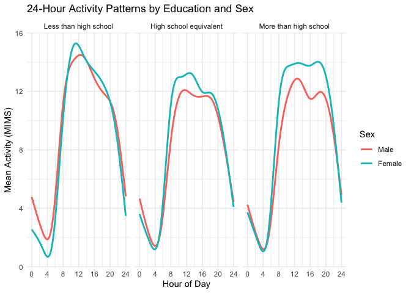

P8105 Homework 3
================
Cecilia Zhao
2026-10-18

## Question 1

``` r
library(p8105.datasets)
data("ny_noaa")

ny_noaa
```

    ## # A tibble: 2,595,176 × 7
    ##    id          date        prcp  snow  snwd tmax  tmin 
    ##    <chr>       <date>     <int> <int> <int> <chr> <chr>
    ##  1 US1NYAB0001 2007-11-01    NA    NA    NA <NA>  <NA> 
    ##  2 US1NYAB0001 2007-11-02    NA    NA    NA <NA>  <NA> 
    ##  3 US1NYAB0001 2007-11-03    NA    NA    NA <NA>  <NA> 
    ##  4 US1NYAB0001 2007-11-04    NA    NA    NA <NA>  <NA> 
    ##  5 US1NYAB0001 2007-11-05    NA    NA    NA <NA>  <NA> 
    ##  6 US1NYAB0001 2007-11-06    NA    NA    NA <NA>  <NA> 
    ##  7 US1NYAB0001 2007-11-07    NA    NA    NA <NA>  <NA> 
    ##  8 US1NYAB0001 2007-11-08    NA    NA    NA <NA>  <NA> 
    ##  9 US1NYAB0001 2007-11-09    NA    NA    NA <NA>  <NA> 
    ## 10 US1NYAB0001 2007-11-10    NA    NA    NA <NA>  <NA> 
    ## # ℹ 2,595,166 more rows

``` r
nrow(ny_noaa)
```

    ## [1] 2595176

``` r
ncol(ny_noaa)
```

    ## [1] 7

``` r
missing_summary =
  ny_noaa |>
  summarise(
    missing_prcp = mean(is.na(prcp)) * 100,
    missing_snow = mean(is.na(snow)) * 100,
    missing_snwd = mean(is.na(snwd)) * 100,
    missing_tmax = mean(is.na(tmax)) * 100,
    missing_tmin = mean(is.na(tmin)) * 100
  )

missing_summary |>
  knitr::kable(digits = 2)
```

| missing_prcp | missing_snow | missing_snwd | missing_tmax | missing_tmin |
|-------------:|-------------:|-------------:|-------------:|-------------:|
|         5.62 |        14.69 |         22.8 |        43.71 |        43.71 |

The `ny_noaa` dataset contains 2595176 observations and 7 variables,
including weather station ID, date, precipitation (`prcp`), snowfall
(`snow`), snow depth (`snwd`), maximum temperature (`tmax`), and minimum
temperature (`tmin`).

Missing data are a substantial issue in this dataset. Precipitation has
the lowest percentage of missing values (5.62%), followed by snowfall
(14.69%) and snow depth (22.8%). Maximum and minimum temperatures have
the highest missing percentages, both at 43.71%.

``` r
ny_noaa_df =
  ny_noaa |>
  mutate(
    year = lubridate::year(date),
    month = lubridate::month(date),
    day = lubridate::day(date),
    tmax = as.numeric(tmax) / 10,
    tmin = as.numeric(tmin) / 10,
    prcp = prcp / 10
  )
```

``` r
snow_summary =
  ny_noaa_df |>
  filter(!is.na(snow)) |>
  count(snow, sort = TRUE)

snow_summary |>
  head(10) |>
  knitr::kable()
```

| snow |       n |
|-----:|--------:|
|    0 | 2008508 |
|   25 |   31022 |
|   13 |   23095 |
|   51 |   18274 |
|   76 |   10173 |
|    8 |    9962 |
|    5 |    9748 |
|   38 |    9197 |
|    3 |    8790 |
|  102 |    6552 |

The most commonly observed snowfall value is 0 mm, which occurres
2008508 times. This is expected because most days do not experience
snowfall.

Other frequently observed values include 25, 13, 51, and 76 mm. These
values are approximately equivalent to common fractions or multiples of
an inch. It suggests that the observed frequencies may reflect
measurement conventions and rounding when converting from inches to
millimeters.

``` r
temp_summary =
  ny_noaa_df |>
  filter(month %in% c(1, 7)) |>
  group_by(id, year, month) |>
  summarise(
    mean_tmax = mean(tmax, na.rm = TRUE),
    .groups = "drop"
  ) |>
  filter(!is.na(mean_tmax))
```

``` r
temp_summary |>
  ggplot(aes(x = year, y = mean_tmax, group = id)) +
  geom_point(alpha = 0.5) +
  scale_x_continuous(breaks = seq(1980, 2010, 10)) +
  facet_grid(. ~ month,
           labeller = as_labeller(c(`1` = "January", `7` = "July"))) +
  labs(
    title = "Average Maximum Temperature in January and July",
    x = "Year",
    y = "Average Maximum Temperature (°C)"
  ) +
  theme_minimal()
```

<!-- -->

The plot shows a clear seasonal difference in average maximum
temperatures between January and July. January temperatures are
generally much lower and more variable. July temperatures are higher and
more concentrated. There is some variation across years, but no obvious
long-term trend.

A few potential outliers are visible in both months, particularly
unusually low average temperatures in January and July. These values may
reflect extreme weather conditions or incomplete observations and would
require further investigation.

``` r
ggp_temp =
  ny_noaa_df |>
  drop_na(tmax, tmin) |>
  ggplot(aes(x = tmin, y = tmax)) +
  geom_hex() +
  labs(
    title = "Maximum vs Minimum Temperature",
    x = "Minimum Temperature (°C)",
    y = "Maximum Temperature (°C)"
  ) +
  theme_minimal()
```

``` r
ggp_snow =
  ny_noaa_df |>
  filter(snow > 0, snow < 100) |>
  ggplot(aes(x = snow)) +
  geom_density() +
  facet_wrap(~ year, ncol = 5) +
  labs(
    title = "Distribution of Snowfall by Year",
    x = "Snowfall (mm)",
    y = "Density"
  ) +
  theme_minimal()
```

``` r
combined_plot =
  (ggp_temp / ggp_snow) +
  plot_annotation(
    title = "Temperature and Snowfall in New York",
    tag_levels = "A"
  )

combined_plot
```

<!-- -->
Panel A: Maximum vs Minimum Temperature：

The plot shows a clear positive relationship between minimum and maximum
temperatures. As minimum temperature increases, maximum temperature
generally increases as well. There are a few potential outliers appear
at unusually high or low temperatures. A hexbin plot is more appropriate
than a scatterplot for this large dataset because it reduces
overplotting and makes the concentration of observations easier to see.

Panel B: Distribution of Snowfall by Year:

My code focuses on snowfall values greater than 0 and less than 100 mm.
So I excluded days with no snowfall and observations with snowfall of
100 mm or more.

The distributions of snowfall are relatively consistent across years.
There is no obvious long-term changes in their overall shapes. Smaller
snowfall amounts are more common, and larger snowfall amounts occur less
frequently. Several peaks appear at similar snowfall values across
years, which may reflect measurement conventions and rounding when
converting snowfall measurements from inches to millimeters.

## Question2

``` r
demographic_df = read_csv("data/nhanes_covar.csv", skip = 4)
```

    ## Rows: 250 Columns: 5
    ## ── Column specification ────────────────────────────────────────────────────────
    ## Delimiter: ","
    ## dbl (5): SEQN, sex, age, BMI, education
    ## 
    ## ℹ Use `spec()` to retrieve the full column specification for this data.
    ## ℹ Specify the column types or set `show_col_types = FALSE` to quiet this message.

``` r
accelerometer_df = read_csv("data/nhanes_accel.csv")
```

    ## Rows: 250 Columns: 1441
    ## ── Column specification ────────────────────────────────────────────────────────
    ## Delimiter: ","
    ## dbl (1441): SEQN, min1, min2, min3, min4, min5, min6, min7, min8, min9, min1...
    ## 
    ## ℹ Use `spec()` to retrieve the full column specification for this data.
    ## ℹ Specify the column types or set `show_col_types = FALSE` to quiet this message.

``` r
dim(demographic_df)
```

    ## [1] 250   5

``` r
dim(accelerometer_df)
```

    ## [1]  250 1441

``` r
head(demographic_df)
```

    ## # A tibble: 6 × 5
    ##    SEQN   sex   age   BMI education
    ##   <dbl> <dbl> <dbl> <dbl>     <dbl>
    ## 1 62161     1    22  23.3         2
    ## 2 62164     2    44  23.2         3
    ## 3 62169     1    21  20.1         2
    ## 4 62174     1    80  33.9         3
    ## 5 62177     1    51  20.1         2
    ## 6 62178     1    80  28.5         2

``` r
demographic_clean =
  demographic_df |>
  filter(
    age >= 21,
    !is.na(sex),
    !is.na(age),
    !is.na(BMI),
    !is.na(education)
  ) |>
  mutate(
    sex = factor(
      sex,
      levels = c(1, 2),
      labels = c("Male", "Female")
    ),
    education = factor(
      education,
      levels = c(1, 2, 3),
      labels = c(
        "Less than high school",
        "High school equivalent",
        "More than high school"
      )
    )
  )
```

``` r
accelerometer_long =
  accelerometer_df |>
  pivot_longer(
    cols = starts_with("min"),
    names_to = "minute",
    values_to = "MIMS"
  ) |>
  mutate(
    minute = as.numeric(
      stringr::str_remove(minute, "min")
    )
  )
```

``` r
nhanes_df =
  accelerometer_long |>
  inner_join(
    demographic_clean,
    by = "SEQN"
  )
```

``` r
education_sex_df =
  demographic_clean |>
  group_by(education, sex) |>
  summarise(
    n = n(),
    .groups = "drop"
  )
```

``` r
education_sex_df |>
  pivot_wider(
    names_from = sex,
    values_from = n
  ) |>
  knitr::kable()
```

| education              | Male | Female |
|:-----------------------|-----:|-------:|
| Less than high school  |   27 |     28 |
| High school equivalent |   35 |     23 |
| More than high school  |   56 |     59 |

``` r
ggplot(demographic_clean,
  aes(x = education, y = age, fill = sex)
) +
  geom_boxplot() +
  labs(
    title = "Age Distribution by Education Level and Sex",
    x = "Education Level",
    y = "Age (years)",
    fill = "Sex"
  ) +
  theme_minimal()
```

<!-- -->

The age distributions vary across education levels and sex. Participants
with less than a high school education generally have higher median
ages, which are around 60 years for both men and women. In the high
school equivalent group, women have a higher median age than men.
Participants with more than a high school education tend to be younger,
with median ages in the early to mid-40s for both sexes. Overall, the
results suggest that age distributions differ across education
categories, although there is considerable overlap between groups.

``` r
daily_activity_df =
  nhanes_df |>
  group_by(SEQN, sex, age, BMI, education) |>
  summarise(
    total_activity = sum(MIMS),
    .groups = "drop"
  )
```

``` r
ggplot(
  daily_activity_df,
  aes(x = age, y = total_activity, color = sex)
) +
  geom_point(alpha = 0.6) +
  geom_smooth(se = FALSE) +
  facet_wrap(~ education) +
  labs(
    title = "Total Daily Activity by Age, Sex, and Education",
    x = "Age (years)",
    y = "Total Daily Activity (MIMS)",
    color = "Sex"
  ) +
  theme_minimal()
```

<!-- -->

The scatterplots suggest that total daily activity generally decreases
with age, particularly among older participants. Female participants
tend to have slightly higher activity levels than male participants in
several age ranges, but this pattern is not consistent across all
education groups. The high school equivalent group shows more
fluctuations in activity trends. The more than high school group
exhibits relatively stable activity levels through middle age, followed
by a decline among older participants. Overall, the results suggest an
association between age and daily activity, with some differences by sex
and education level.

``` r
activity_time_df =
  nhanes_df |>
  group_by(education, sex, minute) |>
  summarise(
    mean_MIMS = mean(MIMS),
    .groups = "drop"
  ) |>
  mutate(
    hour = (minute - 1) / 60
  )
```

``` r
ggplot(
  activity_time_df,
  aes(x = hour, y = mean_MIMS, color = sex)
) +
  geom_smooth(se = FALSE) +
  facet_wrap(~ education) +
  scale_x_continuous(
    breaks = seq(0, 24, 4)
  ) +
  labs(
    title = "24-Hour Activity Patterns by Education and Sex",
    x = "Hour of Day",
    y = "Mean Activity (MIMS)",
    color = "Sex"
  ) +
  theme_minimal()
```

    ## `geom_smooth()` using method = 'gam' and formula = 'y ~ s(x, bs = "cs")'

<!-- -->

The 24-hour activity patterns show a clear daily cycle across all three
education levels. Activity levels are lowest during the early morning
hours, increase rapidly after approximately 6 AM, remain relatively high
throughout the day, and decline in the evening. Female participants
generally have higher mean activity levels than male participants during
daytime hours. Participants with less than a high school education show
a pronounced peak around midday. Those with a high school equivalent
education exhibit relatively lower daytime activity levels. Overall, the
results suggest similar daily activity patterns across education groups,
with some differences in activity intensity by sex and education level.

## Question 3

``` r
jan_2020 = read_csv("data/citibike/Jan 2020 Citi.csv.zip")
```

    ## Rows: 12420 Columns: 7
    ## ── Column specification ────────────────────────────────────────────────────────
    ## Delimiter: ","
    ## chr (6): ride_id, rideable_type, weekdays, start_station_name, end_station_n...
    ## dbl (1): duration
    ## 
    ## ℹ Use `spec()` to retrieve the full column specification for this data.
    ## ℹ Specify the column types or set `show_col_types = FALSE` to quiet this message.

``` r
july_2020 = read_csv("data/citibike/July 2020 Citi.csv.zip")
```

    ## Rows: 21048 Columns: 7
    ## ── Column specification ────────────────────────────────────────────────────────
    ## Delimiter: ","
    ## chr (6): ride_id, rideable_type, weekdays, start_station_name, end_station_n...
    ## dbl (1): duration
    ## 
    ## ℹ Use `spec()` to retrieve the full column specification for this data.
    ## ℹ Specify the column types or set `show_col_types = FALSE` to quiet this message.

``` r
jan_2024 = read_csv("data/citibike/Jan 2024 Citi.csv.zip")
```

    ## Rows: 18861 Columns: 7
    ## ── Column specification ────────────────────────────────────────────────────────
    ## Delimiter: ","
    ## chr (6): ride_id, rideable_type, weekdays, start_station_name, end_station_n...
    ## dbl (1): duration
    ## 
    ## ℹ Use `spec()` to retrieve the full column specification for this data.
    ## ℹ Specify the column types or set `show_col_types = FALSE` to quiet this message.

``` r
july_2024 = read_csv("data/citibike/July 2024 Citi.csv.zip")
```

    ## Rows: 47156 Columns: 7
    ## ── Column specification ────────────────────────────────────────────────────────
    ## Delimiter: ","
    ## chr (6): ride_id, rideable_type, weekdays, start_station_name, end_station_n...
    ## dbl (1): duration
    ## 
    ## ℹ Use `spec()` to retrieve the full column specification for this data.
    ## ℹ Specify the column types or set `show_col_types = FALSE` to quiet this message.
